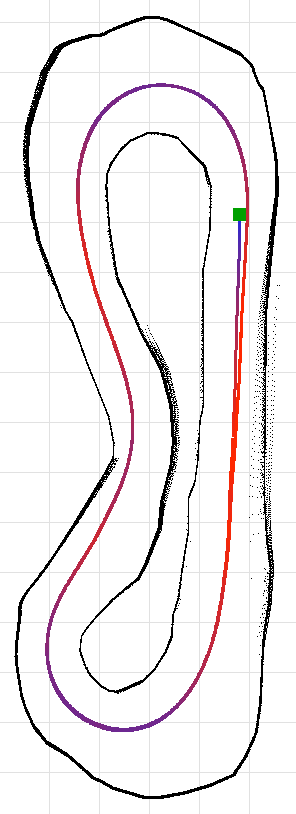

# Penn RoboRacer Technical Challenge: LiDAR wall follower

A ROS 2 (Humble) node that drives the AutoDRIVE RoboRacer practice track (IROS 2026 practice
simulator) from its LiDAR scan.

| | |
|---|---|
| **Fastest clean lap** | **5.994 s** (default configuration; simulator lap timer) |
| **Consecutive clean laps** | **31 of 31** in one run of the real node (`ros2 run`, default parameters): best 5.994 s, mean 6.012 ± 0.009 s, slowest flying lap 6.031 s. |
| **Video** | https://youtu.be/9fVgYthED2A (unlisted YouTube, Driver's Eye camera; the HUD in the video shows the simulator's lap timer, best lap 6.014 s in that session, collision counter 0) |
| **Node** | [`autodrive_devkit/autodrive_roboracer/wall_follow_node.py`](autodrive_devkit/autodrive_roboracer/wall_follow_node.py) |

All lap times are the simulator's own lap timer, the same clock the HUD shows. "Flying laps"
means lap 2 onward: a reset does not restart the timer, so lap 1 also contains the idle time
before the car starts.



*Default configuration on the practice track. Blue is slow, red is fast (7.6 m/s). The car runs
clockwise from the green square. Walls are drawn from logged LiDAR scans.*

## Two configurations

The node ships with one default and two alternative parameter files. They share the wall fits,
the side guard, the speed logic and the traction control; they differ in what the steering aims
at.

| Configuration | Steering reference | Mean flying lap (s) | How to run |
|---|---|---|---|
| **Default** | Free-space aim point: the centre of the free sector at a lookahead range, on a disparity-extended scan (follow-the-gap style). The two fitted walls provide centring, the side guard and the speed limits. | **6.01** (see below) | `ros2 run autodrive_roboracer wall_follow_node` |
| Two-wall + corner preview | Midline between the two fitted walls, PD, plus a small bias towards the deepest free direction | 6.44 ± 0.27 (best 6.32) | `--ros-args --params-file .../config/two_wall_preview.yaml` |
| Pure two-wall | Midline between the two fitted walls, PD, nothing else | 7.33 ± 0.04 | `--ros-args --params-file .../config/two_wall_pure.yaml` |

The challenge asks for a wall follower. The default configuration's primary steering reference
is the free space ahead, not the walls; the walls are secondary (centring with a small gain, the
side guard, and all speed limits come from wall and scan distances). If a strict two-wall
follower is wanted, the second configuration is the one to judge: it is the same node with
`steer_mode:=pd`, and every number for it is in the tables below.

## How it works

Each LiDAR scan (1080 beams over 270°) produces one steering and one throttle command.

**Walls.** For each side, beam *b* points 90° to the side and beam *a* 50° further forward.
For a straight wall, `tan α = (a·cos θ − b) / (a·sin θ)` gives the car's angle to the wall and
`D = b·cos α` its distance. The centring error is `(D_left − D_right) / 2`, projected a little
ahead. Wall-angle and error clamps reject bad fits. A side guard adds steering away from any wall
closer than 0.37 m.

**Steering (default).**
1. *Disparity extension.* Wherever two neighbouring beams differ by more than 0.3 m, the nearer
   range is copied over the beams the car's half width would sweep at that distance. A direction
   left free afterwards is one the car fits through.
2. *Aim point.* Among the beams longer than the lookahead range (1.93 m + 0.20 m per m/s of
   speed), the contiguous free sector containing the deepest direction is chosen and the car aims
   at its centre. If nothing is free at that range, the range shrinks (down to 1.17 m). The aim
   point is shifted 0.24 m towards the inside of the turn (`apex_shift`).
3. *Pure pursuit.* The steering angle is the arc that reaches the aim point:
   `κ = 2·sin θ / L`, `δ = atan(κ · wheelbase)`. A small PD term on the wall-centring error
   (kp 0.084) and the side guard are added.

**Steering (two-wall configurations).** `δ = kp · error` with kp 0.42, plus the derivative term,
the optional corner-preview bias (`preview_gain` × the deepest direction) and the side guard.

**Speed.** The target speed is the lowest of three limits: the top speed `v_max`; braking
`√(v_corner² + 2·a_brake·d)` where `d` is the free distance along the arc the car is steering on;
and cornering `√(a_lat / κ)` from the commanded curvature. Throttle in this simulator sets wheel
speed (steady speed ≈ 25 m/s × throttle), so `throttle = v_target / 25` plus a speed-error term
from odometry, capped by traction control (wheel speed at most 16 % + 0.5 m/s above the car's
speed; full throttle from low speed spins the wheels).

`a_lat` is a cornering *speed target*, tuned slightly above the measured steady-state grip
(8.34 vs about 8 m/s²): on corner entry the car routinely exceeds it while braking, and the
protection against walls comes from the arc-clearance braking, not from this limit.

**Plumbing.** The LiDAR produces about 40 new scans per second and the bridge republishes each
one 3–5 times; steering is recomputed only on a new scan, throttle on every message. On Ctrl+C
or SIGTERM the node publishes zero throttle and steering before it exits (the bridge replays the
last command forever otherwise). Malformed scans are ignored. Every tunable is a ROS parameter
and can be changed live.

## Results

### From baseline to final

Each row is 3 runs × 4 laps (9 flying laps), runs interleaved across variants. Mean ± standard
deviation of the flying laps; laps within a run are correlated, so treat the ± as spread, not as a
confidence interval.

| Version | Mean flying lap (s) | Best (s) | Clean runs |
|---|---|---|---|
| Textbook wall follower, left wall (F1TENTH lab: PD, 1.5/1.0/0.5 m/s by steering angle) | 24.080 ± 0.042 | 24.036 | 3/3 |
| Textbook wall follower, right (inner) wall | 21.015 ± 0.084 | 20.897 | 3/3 |
| Two-wall PD, hand-tuned speed logic (centring, arc braking, cornering limit, preview, speed feedback) | 7.104 ± 0.043 | 7.052 | 3/3 |
| Two-wall PD + traction control, parameters tuned with CMA-ES | 6.374 ± 0.055 | 6.299 | 3/3 |
| Free-space aim point (pursuit), first CMA-ES stage | 6.084 ± 0.006 | 6.076 | 3/3 |
| **Free-space aim point, second CMA-ES stage (default)** | **6.014 ± 0.008** | **6.007** | **3/3** |
| Default, re-measured with the shipped build | 6.011 ± 0.004 | 6.004 | 3/3 |
| Default, real node (`ros2 run`), 31 laps in a row | 6.012 ± 0.009 (30 flying laps) | 5.994 | 1/1 |

Search scores are not quoted anywhere: every number above is a re-measurement of a fixed
configuration.

### Ablation: remove one component from the default configuration

3 runs × 4 laps per variant, interleaved.

| Variant | Mean flying lap (s) | Δ (s) | Clean runs |
|---|---|---|---|
| **Default** | **6.014 ± 0.008** | – | 3/3 |
| − speed-dependent lookahead (fixed 1.93 m) | 7.436 ± 0.207 | +1.42 | 3/3 |
| − speed feedback | 6.752 ± 0.007 | +0.74 | **2/3** |
| − arc clearance (straight-ahead corridor) | 6.621 ± 0.005 | +0.61 | 3/3 |
| two-wall PD steering instead of the aim point (same speed envelope) | 6.468 ± 0.320 | +0.45 | 3/3 |
| − wall-centring term (kp = 0) | 6.151 ± 0.017 | +0.14 | 3/3 |
| − traction control | 6.101 ± 0.007 | +0.09 | 3/3 |
| − apex shift | 6.098 ± 0.004 | +0.08 | 3/3 |
| − disparity extension | 6.071 ± 0.167 | +0.06 | 3/3 |
| − corner speed (`v_corner = 0`) | 6.050 ± 0.004 | +0.04 | **1/3** |
| − side guard | 6.025 ± 0.005 | +0.01 | 3/3 |
| aim-point steering with the earlier (two-wall) speed envelope | 6.088 ± 0.004 | +0.07 | 3/3 |

The last two rows separate the steering change from the speed re-tune: the aim point with the
earlier speed envelope is already at 6.09 s, while two-wall steering with the new envelope stays
at 6.47 s. The speed-dependent lookahead, the speed feedback and the arc clearance each carry
more than half a second. The wall-centring term, traction control and the apex shift are worth about a
tenth each. Two variants that are not slower by much crashed: without the corner-speed term
(2 wall contacts in 3 runs) and without speed feedback (1 in 3), both at the exit of the bottom
hairpin. The side guard shows no measurable effect and stays as a safety margin.

### Parameter tuning (CMA-ES)

Parameters were tuned with CMA-ES ([`tools/tune.py`](tools/tune.py)) directly in the simulator:
one evaluation is a reset plus 3 laps, the score is the mean of laps 2–3, and a wall contact
scores 12 s.

| Stage | Steering | Parameters | Evaluations | Clean | Best score |
|---|---|---|---|---|---|
| 1 | two-wall PD | 10 | 60 | 60 | 6.53 |
| 2 | two-wall PD, kp and lookahead ranges widened | 10 | 30 | 30 | 6.32 |
| 3 | aim point | 12 | 35 | 34 | 6.09 |
| 4 | aim point, from the stage-3 winner with a smaller step | 12 | 42 | 42 | 6.01 |

Every winner was re-measured from scratch (3 runs × 4 laps, interleaved with the previous
configuration) before being adopted. The expected optimism of a best-of-42 score with this lap
noise is 0.01–0.02 s; the re-measurements agreed with the scores within that.

### Measurements that shaped the design

| Measured in the simulator | Design consequence |
|---|---|
| Throttle sets wheel speed: steady speed ≈ 25 m/s × throttle | `throttle = v_target / 25` + speed feedback |
| Full throttle from low speed spins the wheels (5.4 vs 7.4 m/s after 1.2 s) | traction control |
| Braking is ≈ 6 m/s² for any throttle below the current speed | no special braking logic |
| Steering onset latency ≈ 20 ms; the kinematic model matches at low lateral acceleration | kinematic pure pursuit is adequate |
| Sustained grip ≈ 8 m/s²; asking for 9–11.5 made laps a full second slower (the car slides wide and hits full lock) | cornering limit near 8 |
| The LiDAR gives ~40 new scans/s; the bridge republishes each 3–5× | steering only on new scans |
| The tuned two-wall car was already at the point-mass speed limit of the line it drove (5.96 s ideal on a 30.4 m path vs 6.31 actual) while a shorter line allowed 5.74 s | the remaining time was in the line, which led to the aim-point steering |

[`tools/sysid.py`](tools/sysid.py) reproduces the acceleration, braking and steering
measurements; [`tools/lap_analysis.py`](tools/lap_analysis.py) compares a driven lap to the ideal
profile on its own path, segment by segment.

### Things that did not work

- **Pure-pursuit geometry on the wall-centring error** (`steer_law:=pursuit_wall`, gain falling
  with speed): 7.1–8.1 s. At hairpin speeds its gain is high, the steering saturates, and the
  cornering limit then holds the car to ~2 m/s. Kept in the code, off by default.
- **Stiffer two-wall gains** (kp 0.9 with the tuned speed logic): 7.25–7.96 s, same saturation.
- **A bounded inside-of-corner offset on the two-wall law**: 6.39 s, no gain.
- **Cornering limits above the measured grip** (9–11.5 m/s²): 7.2–7.4 s.
- **Longer aim-point lookahead** (2.5 m): the car cut the bottom hairpin too early and nearly
  stalled at the apex (6.6 s).

## Robustness

- **Consecutive laps.** **31 of 31** in one run of the real node (`ros2 run`, default parameters): best 5.994 s, mean 6.012 ± 0.009 s, slowest flying lap 6.031 s. An earlier 31-lap attempt with the same configuration ended
  in a wall contact in lap 2, at the left-side S-bend; its trace shows a 0.36 s gap with no scan
  messages just before the contact, while a test suite was running on the same machine. The car
  covered 1.85 m blind at 5 m/s. Timing-critical runs were made with the machine otherwise idle
  after that. One run of 31 laps bounds the per-lap contact probability to roughly below 10 %; it
  does not prove the car never touches a wall.
- **Tightest spot.** The default line passes the left wall at 0.33 m (LiDAR to wall, about
  0.17 m of body clearance) at 4.8 m/s in the left-side S-bend; the two-wall configurations pass
  it at 0.41 m. A wider side clearance (0.43 m) gains only 2 cm there and costs 0.08 s per lap.
- **Offline checks** (`tests/test_closed_loop.py`): the default and the two-wall configurations
  finish laps on the mirrored, counter-clockwise track, at a 40 Hz control rate, with 2 cm LiDAR
  noise and with 75 ms of extra command latency.
- **Shutdown.** Ctrl+C on the node at 4.4 m/s brought the car to a stop, with the bridge
  reporting throttle 0.

## Run it

Prerequisites: Docker Desktop, Git, and the IROS 2026 **practice** simulator.

```powershell
docker build --platform linux/amd64 -t penn-challenge -f autodrive_devkit.Dockerfile .
.\scripts\dev.ps1 up     # container + colcon build + bridge in the background (Windows)
.\scripts\dev.ps1 run    # start wall_follow_node with the default parameters
```

Or use the commands from the challenge sheet: `ros2 launch autodrive_roboracer
bringup_headless.launch.py`, then `ros2 run autodrive_roboracer wall_follow_node`. In the
simulator connect to `127.0.0.1:4567` and set Driving Mode to **Autonomous**.

```bash
# two-wall follower with corner preview (~6.4 s)
ros2 run autodrive_roboracer wall_follow_node --ros-args --params-file \
  /home/autodrive_devkit/src/autodrive_devkit/config/two_wall_preview.yaml
# pure two-wall follower (~7.3 s)
ros2 run autodrive_roboracer wall_follow_node --ros-args --params-file \
  /home/autodrive_devkit/src/autodrive_devkit/config/two_wall_pure.yaml
# hand-tuned two-wall configuration (~7.1 s, the most conservative)
ros2 run autodrive_roboracer wall_follow_node --ros-args --params-file \
  /home/autodrive_devkit/src/autodrive_devkit/config/hand_tuned.yaml
```

## Testing

| What | Where | Runs in |
|---|---|---|
| Unit tests on synthetic scans: wall geometry, signs, invalid and empty scans, disparity extension, aim-point selection and fallback, repeated scans, speed modes, traction control, parameter validation | `autodrive_devkit/test/test_wall_follow.py` | CI + container |
| Closed-loop tests in a small offline simulator on a replica of the track: both directions, 40 Hz control, LiDAR noise, command latency; also checks that a constant 4 m/s *does* crash, as it does in the real simulator | `tests/test_closed_loop.py`, `tools/sim2d.py` | CI + container |
| Timed laps in the real simulator: reset, lap count, wall contacts, per-scan trace, code hash per result | `tools/experiment.py`, `tools/summarize.py` | container + simulator |

GitHub Actions runs flake8, `colcon build` and both test suites in a `ros:humble` container on
every push. The offline simulator is calibrated to the measured acceleration, braking and grip,
but it is a kinematic model: it catches regressions and does not predict lap times (it predicted a
gain for `pursuit_wall` that the real simulator did not show).

## Reproducing the experiments

| Experiment | Script | Results |
|---|---|---|
| Textbook baselines, hand-tuned two-wall ablation | `experiments/final.sh` | `results_final.jsonl` |
| Two-wall CMA-ES winners, ablation, 31-lap run | `validate_tuned.sh`, `final2.sh` | `results_tuned_final.jsonl` |
| Aim-point validation, ablation, 31-lap runs | `validate_gap.sh`, `final3.sh`, `final3b.sh` | `results_pursuit_final.jsonl` |
| Screening rounds | `screen*.sh` | `results_screening*.jsonl` |
| CMA-ES search (all four stages) | `tools/tune.py` | `tuning_history.jsonl` |

`python3 tools/summarize.py <file>` prints any of these as a table. Runs need the simulator in
headless batch mode (`.\scripts\dev.ps1 headless` starts it and the bridge in the right order:
the simulator first, or the bridge raises a `KeyError` on the first message and stalls).

## Notes and limitations

- All results were measured in headless batch mode on one PC. The GUI mode used for the video
  also renders, which can change message timing; the parameter files above are the conservative
  fallbacks.
- Run one ROS container at a time: containers on the same Docker network discover each other's
  topics and two controllers would drive the same car (`ROS_DOMAIN_ID` separates them).
- The parameters are tuned for this track. The algorithm is symmetric and passes the mirrored
  track offline, but the numbers are specific to this geometry.

## Repository layout

```
autodrive_devkit/            ROS 2 package from AutoDRIVE + wall_follow_node.py (bridge unchanged)
  config/*.yaml              alternative parameter files (two-wall, hand-tuned)
autodrive_devkit.Dockerfile  unchanged from AutoDRIVE, so the image builds from this repo
tools/experiment.py          automated timed laps in the simulator
tools/tune.py                CMA-ES parameter search
tools/sysid.py               acceleration / braking / steering measurements
tools/lap_analysis.py        time lost per path segment vs the ideal profile
tools/lap_bound.py           ideal lap time on a fixed path
tools/sim2d.py               offline simulator used by the closed-loop tests
tools/summarize.py           results tables
tools/track_map.py           track map from logged scans
tests/                       closed-loop tests + track replica
experiments/                 experiment scripts and raw results
scripts/                     Windows helpers: dev.ps1 (up/run/headless/test/shell/down), tune_up.ps1
```

AutoDRIVE files are BSD-licensed, Copyright (c) AutoDRIVE / Tinker Twins (see `LICENSE.AutoDRIVE`).
